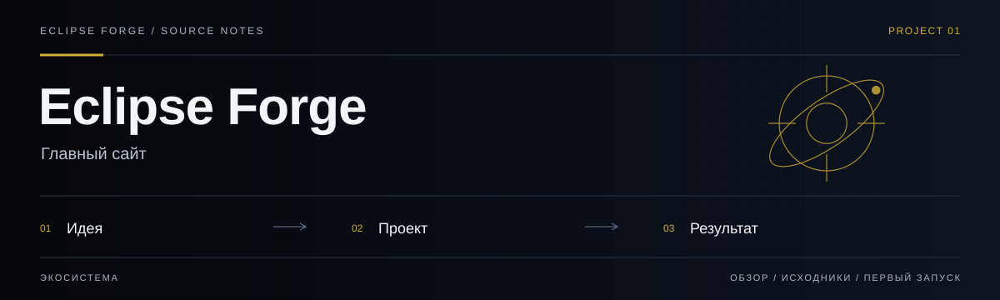
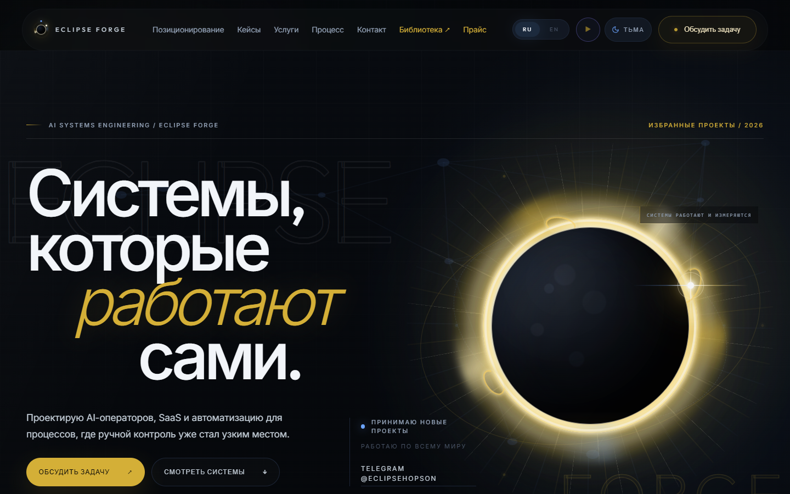
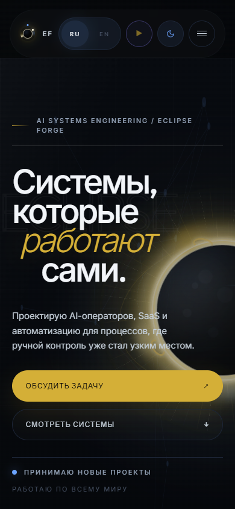

# Eclipse Forge



**Главный сайт.** Вход в экосистему продуктов, инженерных проектов и общих стандартов Eclipse Forge.

<!-- repository-guide:start -->
[Интерфейс](#readme-interface) · [Первый запуск](#readme-start) · [Что внутри](#readme-map) · [Путеводитель](docs/repository-guide.md#start) · [Карта кода](docs/repository-guide.md#map) · [Проверки](docs/repository-guide.md#checks) · [Границы и права](docs/repository-guide.md#boundaries)

<a id="readme-interface"></a>

## Интерфейс



**Главная страница Eclipse Forge: позиционирование и вход в продукты экосистемы.**

Локальный снимок от 8 сентября 2026: отдельный профиль браузера, без внешних API и пользовательских секретов. Это вид интерфейса, не подтверждение production-функций.

<details>
<summary><strong>Мобильный экран · 390 px</strong></summary>



</details>

[Открыть в полном размере](docs/assets/ui/overview.png) · [Данные снимка](docs/assets/ui/capture.json)

<a id="readme-map"></a>

## Проект за минуту

- **[Главная страница](<src/pages/LandingPage.tsx>)** — Композиция витрины и вход в продукты экосистемы.
- **[Реестр продуктов](<public/ecosystem/manifest.json>)** — Роли продуктов и контракты интеграций в машиночитаемом виде.
- **[Eclipse Forge OS](<docs/eclipse-forge-os/README.md>)** — Общие стандарты, архитектура и владение продуктами.

<a id="readme-start"></a>

## Начать локально

**Среда:** Node.js и npm. **Источник:** [package.json](<package.json>).

Из корня клонированного репозитория:

```bash
npm ci
npm run dev
```

Запуск сервера разработки не выполняет публикацию. Проверьте настройки окружения и основной пользовательский сценарий перед выпуском.

<details>
<summary><strong>Перед первым запуском и изменением кода</strong></summary>

- Команды сверены с исходниками 8 сентября 2026. Это инструкция, а не отметка об успешном запуске или текущем production.
- Установка зависимостей может обращаться в registry и выполнять lifecycle scripts. Используйте отдельную рабочую среду и демонстрационные данные.
- Центральные документы описывают общие договорённости; runtime и эксплуатационные инструкции принадлежат отдельным продуктам.
- [ROADMAP.md](<ROADMAP.md>)

</details>
<!-- repository-guide:end -->

[Интерактивная витрина 36 проектов](docs/portfolio/README.md) — локальный просмотр без установки.

## Ecosystem control plane

Репозиторий публикует versioned registry экосистемы в `public/ecosystem/manifest.json`.
Он описывает роли продуктов, владение данными и зрелость интеграций, не выдавая запланированные API за готовые.

- Eclipse Forge OS: [`docs/eclipse-forge-os/`](docs/eclipse-forge-os/README.md)
- Архитектура: [`docs/eclipse-forge-os/architecture.md`](docs/eclipse-forge-os/architecture.md)
- Security и releases: [`docs/eclipse-forge-os/security-and-release-runbook.md`](docs/eclipse-forge-os/security-and-release-runbook.md)
- Локальный health report: `docs/portfolio-status.generated.md` (генерируется командой ниже и не коммитится)

```bash
npm run audit:portfolio
npm run validate:ecosystem
npm test
npm run typecheck
npm run build
```

Portfolio audit читает только Git metadata и имена файлов. Он не читает значения секретов и не изменяет соседние репозитории.

## Размещение: Cloudflare Pages

Ниже — конфигурация размещения Vite-сборки в `Cloudflare Pages`, а не отчёт о текущем deployment.

Настройки проекта:

- Framework preset: `Vite`
- Production branch: существующая ветка, выбранная владельцем для выпуска
- Build command: `npm run build`
- Output directory: `dist`
- Root directory: оставить пустым
- Environment variables: не нужны

Порядок деплоя:

1. Создать новый проект в Cloudflare Pages
2. Подключить GitHub-репозиторий `PavelHopson/Eclipse-forge-website`
3. Указать настройки выше
4. Запустить первый deploy
5. После публикации проверить `production URL` и `branch preview`

## Домен

Если домен ещё не подключён, настройка выполняется в Cloudflare Pages:

1. Открыть проект в Cloudflare Pages
2. Перейти в `Custom domains`
3. Добавить домен или поддомен
4. Привязать DNS внутри Cloudflare

## Contact flow

Сайт подготовлен к работе без Netlify Forms.

Текущий сценарий связи:

- primary CTA: Telegram
- secondary CTA: email
- Telegram channel block: активен как брендовый trust-layer

Если позже понадобится вернуть форму, лучше подключить отдельный backend endpoint или form provider, который не зависит от Netlify.

## Локальная разработка

```bash
npm ci
npm run dev
```

## Сборка

Outfit и Inter self-hosted в `public/fonts/`; лицензии OFL лежат рядом. Production не зависит
от Google Fonts и не отправляет туда запросы браузера.

```bash
npm run build
```
